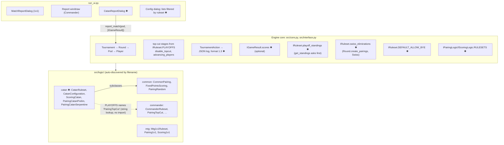
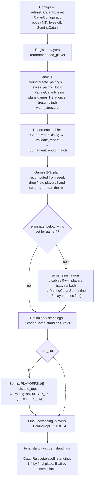
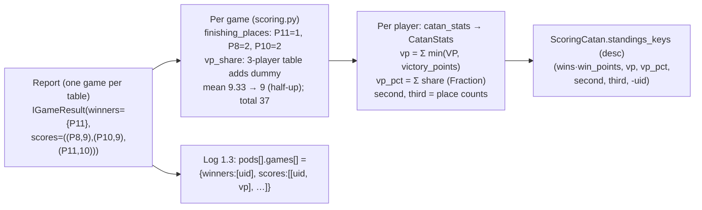

# Catan: how it plugs in

Catan support is a ruleset plug-in in `src/logic/catan/`. The engine did not
change shape. It got one optional field (`IGameResult.scores`) and three opt-in
`IRuleset` hooks. Each hook's default keeps Commander and 1v1 MTG on their old
code path, and `tests/test_golden.py` checks this. Rules reference:
<https://catanevents.com/hosts/tournament-rules/> (rule numbers below).
Authoritative contracts: `docs/tournament-log-spec.md` (`CatanRuleset`,
`ScoringCatan`, `PairingCatanPrelim`, `PairingCatanSerpentine`, format 1.3).

## Architecture

✱ = added for Catan. Game directories never import each other
(`tests/test_logic_layout.py:16-20`).

| Seam | Default (Commander, MTG) | Catan |
|---|---|---|
| `IGameResult.scores` | `None`, not written to the log | VP for every seated player, required |
| `playoff_standings()` | `None`: core's built-in playoff order runs | Rule 1.4.4 ordering |
| `swiss_eliminations()` | Not overridden, so core never calls it | Disables players below `eliminate_below_wins` |
| `DEFAULT_ALLOW_BYE` | `True` | `False` (3-player tables absorb the remainder) |
| `RULESETS` on a logic | `None` = offered for every game | `("CatanRuleset",)` |
| Seat-average guard (`StandingsExport._get_avg_seat`, `Pod.__repr__`) | Unchanged | No `global_wr_seats`, so no seat average |

## Event flow

Structure by player count (rule 1.1.5, `recommended_structure(n)`, which reads
the bands from `src/logic/catan/CatanRuleset.setup.yaml`). The config
stays explicit; `CatanRuleset.warn_structure` logs once at game 1 if it differs
or if there are fewer than 12 players.

| Players | Swiss games | Large-event step | Playoffs | Config |
|---|---|---|---|---|
| 12–28 | 3 | — | Final (top 4) | `n_rounds=3, top_cut=4` |
| 29–79 | 3 | — | Semis (top 16) → Final | `n_rounds=3, top_cut=16` |
| 80+ | 4 | 0-win players out before game 4 | Semis (top 16) → Final | `n_rounds=4, top_cut=16`, round 4 `ruleset_params.eliminate_below_wins=1` |

- **Prelim plan** (`PairingCatanPrelim.plan`, `_schedule`): hill climbing over all
  remaining preliminary games. Repeat opponents and repeat 3-player seats
  cost 100× more than repeat play-order positions (rule 1.1.6 priority). The
  seed is `sha256(tour uid | plan start round | sorted field)`, so nothing
  extra is saved. If an earlier round's actual seating differs from the plan,
  the plan restarts after it, with the real seating as history.
- **Game 4** (`PairingCatanSerpentine`): pods sorted 3-seat first, then ranks
  snaked across them, seat order = rank order (rule 1.1.7; the 45-player
  example is a test).
- **Semis/final**: no Catan pairing code. Commander's `PairingTopCut`,
  looked up by name, already gives the rule 1.1.10 seating.
- **Playoff standings** (`playoff_standings`): until every table of the round
  has reported, the previous round's standings stand. Then that round's players
  are grouped by finishing place at their table, with ties broken by the 1.4.2
  chain over preliminary and playoff games. Everyone else keeps the previous order.

## Data

- **Valid report** (`CatanRuleset.validate_report`): exactly one game and one
  winner; VP for exactly the seated players; winner ≥ `victory_points`
  (default 10); everyone else below it. `report_from_winners` always refuses,
  so a Catan win needs VP.
- **Places**: by VP; tied players share the better place (two players on 9 VP
  are both 2nd).
- **VP% (rule 1.4.3)**: own VP / table total, summed over games as exact
  `Fraction`s. A 3-player table adds a dummy fourth score, the mean rounded half
  up (`dummy_score`, not `round()`). The column shows the share (0.2703), not
  a percentage.
- **Byes**: off by default. A forced bye scores `bye_points` (default 0) and
  adds no VP.
- **Lot**: the core's stable UID order.
- **Log**: only raw VP is stored (`games[].scores`, sorted by UID, omitted when
  unset). Places, VP%, standings and the preliminary plan are recomputed on load.
  Every file now says `"format_version": "1.3"`. `players[].decklist` is written
  only when it is set.

## Where to look

Line numbers are as of commit `8e6fce3` and can drift.

| File:line | What |
|---|---|
| `src/logic/catan/rules.py:72` | `CatanRuleset`: pod sizes, `PLAYOFFS`, `DEFAULT_ALLOW_BYE=False`, `CONFIG_CLASS` |
| `src/logic/catan/rules.py:127` | `validate_report` |
| `src/logic/catan/rules.py:201` | `swiss_pairing_logic`: Prelim, or Serpentine on an eliminating round |
| `src/logic/catan/rules.py:211` | `swiss_eliminations` override |
| `src/logic/catan/rules.py:229` | `playoff_standings` override (rule 1.4.4) |
| `src/logic/catan/rules.py:24`, `:107` | `recommended_structure`, `warn_structure` |
| `src/logic/catan/scoring.py:12-32` | `dummy_score`, `vp_share`, `finishing_places` |
| `src/logic/catan/scoring.py:45` | `catan_stats` (shared by scoring and playoff standings) |
| `src/logic/catan/scoring.py:68` | `ScoringCatan` |
| `src/logic/catan/matching.py:42` | `PairingCatanPrelim`; `plan` `:92`, `_schedule` `:129` |
| `src/logic/catan/matching.py:278` | `PairingCatanSerpentine` |
| `src/logic/catan/CatanRuleset.setup.yaml` | Setup profile: untimed rounds, table phase and turn timers, rule 1.1.5 bands, VP companion, `confirmations: all` |
| `src/logic/catan/*.params.yaml` | `victory_points`, `eliminate_below_wins`, `win_points`/`bye_points`, prelim penalties, `seat_win_rates` |
| `src/interface.py:13` | `IGameResult.scores` |
| `src/interface.py:473`, `:550`, `:561` | `DEFAULT_ALLOW_BYE`, `playoff_standings`, `swiss_eliminations` |
| `src/core.py:2251` | `get_standings` asks `playoff_standings` |
| `src/core.py:3948` | `Round.create_pairings` calls `swiss_eliminations` (only if overridden) |
| `src/core.py:3496`, `:957` | `Pod._serialize_game`, `LOG_FORMAT_VERSION` |
| `src/core.py:1029`, `:1084` | `selectable_*_logics(…, ruleset)` and the `RULESETS` filter |
| `src/logic/commander/matching.py:240` | `PairingTopCut` (reused by name) |
| `run_ui.py:438`, `:581` | `_vp_scored`, `CatanReportDialog` |
| `tests/test_catan_*.py`, `tests/test_ui_catan.py` | Rule examples (1.1.7, 1.1.10, 1.4.3), end-to-end runs at 20/40/90 players |
| `tests/test_golden.py`, `tests/golden/` | Frozen Commander/MTG output |

## Adding another game the same way

1. **Freeze first.** Before you touch shared code, make sure
   `tests/test_golden.py` covers the behaviour you could break, and keep it green.
2. **Ruleset.** `src/logic/<game>/rules.py`: an `IRuleset` (`validate_report`,
   `match_winners`, `random_report`, `PLAYOFFS`, pod sizes, `DEFAULT_ALLOW_BYE`)
   plus a `TournamentConfiguration` subclass named by `CONFIG_CLASS`, each with
   a `.params.yaml` sidecar. Keep `IS_COMPLETE = False` until the game works
   end to end.
3. **Scoring and pairing** on the `common` bases, with
   `RULESETS = ("<Game>Ruleset",)`. Reuse another game's logic only by name
   (for example in `PLAYOFFS`), never by import, and add the pairs to
   `tests/test_logic_layout.py`.
4. **Seams, not rewrites.** If the core cannot express a rule, add an opt-in
   hook or optional field whose default is the old path. Per-game result data
   goes in `IGameResult.scores`.
5. **Switch on.** Rule-example tests, an end-to-end run, the spec section in
   `docs/tournament-log-spec.md`, then `IS_COMPLETE = True`. Add a GUI dialog
   only if the existing win/score dialogs cannot capture a result.
